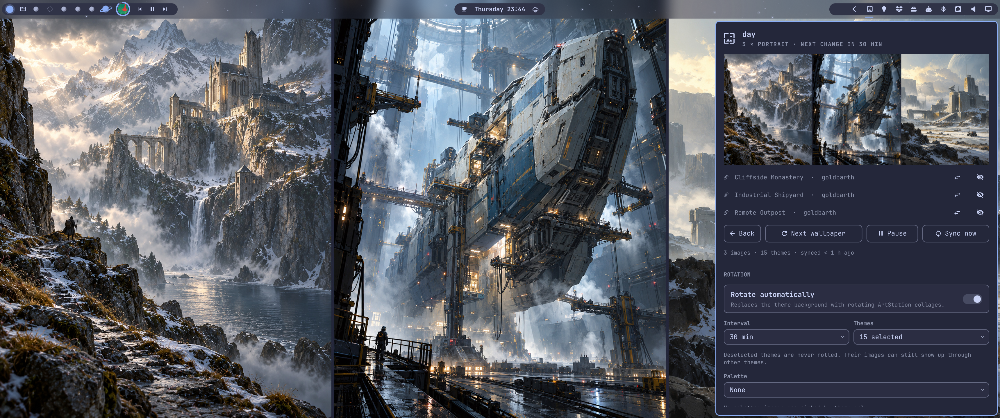
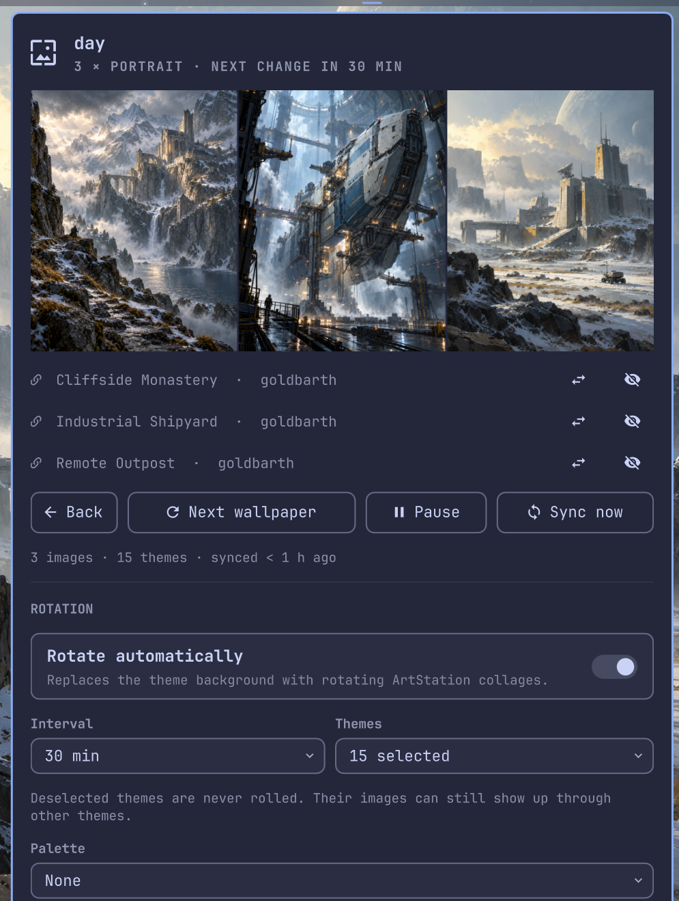

<div align="center">

<picture>
  <source media="(prefers-color-scheme: dark)" srcset="assets/tessella-wordmark.svg">
  
</picture>

**Rotating wallpaper collages from your favorite ArtStation artists, fitted to your screen.**

[](manifest.json)
[](https://plugins.omarchy.org/)
[](#trademarks-and-artwork)
[](LICENSE)


</div>

Tessella is a bar widget and service for [Omarchy](https://omarchy.org/).
You add ArtStation artists, and it turns their work into wallpaper collages that change on a schedule.
Most concept art is portrait, most screens are wide, so a single image rarely fills the desktop well.
The plugin picks a layout that suits your screen, for example three portraits side by side on an ultrawide monitor.

It is a community plugin.
It is not affiliated with, endorsed by, or supported by ArtStation or Epic Games.

<table align="center">
  <tr>
    <td align="center" valign="top">
      
      <br>
      <sub>Three portraits side by side on 21:9</sub>
    </td>
    <td align="center" valign="top">
      
      <br>
      <sub>The panel</sub>
    </td>
  </tr>
</table>

> *Tessella* (Latin) - "a small mosaic tile". One small piece of a much larger world of art.

> [!IMPORTANT]
> Tessella currently works with ArtStation only.
> Would you like images from another site?
> [Open an issue](https://github.com/goldbarth/omarchy-tessella/issues/new) and name the site.
> If it is feasible, I will integrate it.

---

## What it does

- Downloads the public artwork of the artists you add and keeps it up to date once a day.
- Tags every image locally with a vision model (setting, subject, mood, light, color).
- Rolls one or two themes per change, such as `snow + night` or `desert + spaceship`, and builds a collage from images that share them.
- Optionally prefers artwork whose colors fit a palette preset, such as Nord, Gruvbox or Catppuccin Mocha.
- Fits the layout to your screen and re-fits it when you switch monitors, resolution, or rotation.
- Keeps the current collage when you switch the Omarchy theme and redraws it with the new theme's background color between the images.

## Layouts

For portrait (4:5) and landscape (16:9) images, the plugin computes how many fit side by side, or stacked on a portrait screen.
A layout qualifies when a typical image loses at most 20% to cropping.
When several qualify, one is picked at random for each change.

| Screen | Layouts |
|---|---|
| 21:9 | 3 × portrait |
| 16:9, 16:10 | 2 × portrait or 1 × landscape |
| 4:3 | 2 × portrait |
| 32:9 | 4 × portrait or 2 × landscape |
| 9:16 (rotated) | 3 × landscape stacked |

## Palettes

The **Palette** picker in the panel makes the plugin prefer images whose colors fit a preset.
It combines with themes: `snow` with Nord picks snowy images in cool blue-gray tones.
The artwork itself is never recolored.

Presets cover every theme bundled with Omarchy (checked on 2026-10-29) and all variants of Catppuccin (Latte, Frappé, Macchiato, Mocha), Tokyo Night (Night, Storm, Moon, Day) and Rosé Pine (Rosé Pine, Moon, Dawn).

Matching works on colors, not on the vision model's tags:

1. Every sync reduces each new image to its eight dominant colors with ImageMagick.
   For the whole library this takes well under a minute and happens only once per image.
2. A preset is its background, its foreground, the tones between them, and its accent colors.
3. An image matches closely when its dominant colors sit near the preset's colors and it ranks among the best 15% of the library for that preset.
4. If close matches are too few for a varied collage, the next-best images are used and the panel says "relaxed".
   If even those are too few, the palette is ignored for that change, so a small library never gets stuck.

Light presets like Catppuccin Latte or Rosé Pine Dawn find fewer matches in a library of mostly dark concept art.
The panel shows how many images match the selected preset.

Presets live in [`palettes.json`](palettes.json), one line per variant.
To add one, add a variant with an `id`, a `name`, its `background`, `foreground` and `accents`, to an existing or new family.
Nothing else needs to change, and no image has to be analyzed again.

## Requirements

- Omarchy with the Quickshell-based shell (developed on Omarchy 4.0.6, Quickshell 0.3.2).
- `python3`, standard library only.
- ImageMagick 7 (`magick`), for reading image sizes and rendering collages.
- `hyprctl`, to read the screen size. It ships with Hyprland.
- Optional: [Ollama](https://ollama.com/) with a vision model, `gemma3:12b` by default (about 8 GB of VRAM).
  Without it, images are not tagged and collages are picked at random.

## Install

```bash
omarchy plugin add https://github.com/goldbarth/omarchy-tessella --enable
```

If you use Ollama, pull the vision model once:

```bash
ollama pull gemma3:12b
```

> [!NOTE]
> The first sync after adding artists tags every downloaded image, one after another.
> That keeps the GPU near full load and the machine noticeably warmer until it is done.
> On an RTX 4080 Super, one image takes about 1.5 seconds, so 2,000 images take close to an hour.
> Later syncs only tag new images, and Ollama unloads the model two minutes after the last one.
> **Cancel sync** in the panel stops it at any time.
> Images that are not tagged yet are picked up by the next **Sync now** or the next daily sync.
> A smaller `visionModel` lowers the load at the cost of tag quality.

Then click the bar icon, add an artist by username or profile link, and switch on **Rotate automatically**.
The plugin never touches your background before you switch it on.

Move the widget if you want it elsewhere in the bar:

```bash
omarchy bar move goldbarth.tessella --section right
```

## Usage

| Where | Input | Action |
|---|---|---|
| Bar icon | Left click | Toggle the panel |
| Bar icon | Middle click | Next wallpaper |
| Panel | `n` | Next wallpaper |
| Panel | `b` | Back to the previous collage |
| Panel | `p` | Pause or resume rotation |
| Panel | `Esc` | Close |
| Panel | Image title | Open the project on ArtStation |
| Panel | Artist name | Open the profile on ArtStation |

**Back** shows the previous collage again, after **Next** or an automatic change.
It restores the same images and layout, redrawn for the current screen and theme, and the collage it replaces becomes the new previous one.
Only one previous collage is kept.
Back is unavailable when one of its images was removed or its layout does not fit the current screen.

**Pause** keeps the current collage until you resume, without switching rotation off.
Resuming does not change the wallpaper right away; the next change follows one full interval later.
**Next wallpaper** still works while paused, and the pause survives shell restarts.

In the panel you can also change the interval, deselect themes you do not want rolled, sync now or cancel a running sync, and add or remove artists.
Removing an artist deletes their downloaded images.

The plugin can be driven over IPC, for example from a keybinding:

```bash
omarchy-shell goldbarth.tessella next
omarchy-shell goldbarth.tessella back
omarchy-shell goldbarth.tessella togglePause   # also: pause, resume
omarchy-shell goldbarth.tessella toggle
omarchy-shell goldbarth.tessella sync
omarchy-shell goldbarth.tessella cancel
omarchy-shell goldbarth.tessella status
```

## How it works

`Service.qml` decides when to change, sync, or redraw.
`tessella.py` does the work and is also usable from a terminal (`python3 tessella.py next`).

1. **Sync** reads each artist's public RSS feed (`https://www.artstation.com/<user>.rss`, all pages) and downloads new images from the ArtStation CDN.
   It runs on startup when the last sync is older than a day, and right after you add or remove an artist.
2. **Tagging** sends each new image, scaled down to 768 px, to your local Ollama instance (`OLLAMA_HOST`, default `127.0.0.1:11434`).
   Tags come from a fixed vocabulary, so themes stay comparable across artists.
3. **Colors** reduces each new image to its dominant colors for palette matching.
4. **Selection** picks a layout for the screen, then one or two themes, then images that share them.
   With a palette selected, it picks from the images that fit the palette first.
   Each change is anchored on a random artist, so an artist with many images cannot crowd out the others.
   A collage never shows two images from the same project, and recently shown images wait their turn.
   Projects with "cover" or "poster" in the title are skipped, because their title typography looks broken when cropped.
5. **Rendering** composes the collage with ImageMagick and sets it with `omarchy theme bg set`.

Network access goes only to `www.artstation.com` (RSS feeds), `cdn*.artstation.com` (images), and your local Ollama.

## Configuration

Settings live in `~/.config/omarchy/tessella/config.json`.
The panel writes this file, but you can also edit it by hand.

| Key | Default | Description |
|---|---|---|
| `enabled` | `false` | Rotate automatically |
| `paused` | `false` | Hold the current collage; written by **Pause** |
| `resumedAt` | `0` | When rotation was last resumed (epoch seconds); the next change is due one interval later |
| `intervalMinutes` | `30` | Minutes between changes |
| `artists` | `[]` | ArtStation usernames |
| `disabledThemes` | `[]` | Themes that are never rolled |
| `gap` | `10` | Gap between images in pixels |
| `visionModel` | `"gemma3:12b"` | Ollama model used for tagging |
| `palette` | `""` | Palette preset id from `palettes.json`, empty for none |

## Files

| Path | Content |
|---|---|
| `~/.config/omarchy/tessella/config.json` | Settings |
| `~/.local/share/tessella/` | Downloaded images, tag library, current collages |
| `~/.local/state/tessella/` | Sync progress, current selection, history |

Images take about 100 to 450 MB per artist, depending on the size of their portfolio.

## Limitations

- ArtStation is the only image source.
  Other sites can be requested [in an issue](https://github.com/goldbarth/omarchy-tessella/issues/new).
- Tags come from a local model and are sometimes off, colors more often than settings or subjects.
  Palette matching does not use these color tags.
- Covers whose project title does not say "cover" can slip through and show cropped typography.
- On multiple monitors the collage is rendered for the largest one.
  Omarchy shows the same image on every monitor.
- ArtStation offers no public API for this.
  If the RSS feeds change or get blocked, syncing stops working, and already downloaded images keep rotating.
- The plugin runs unsandboxed with your user permissions, like every Omarchy shell plugin.
  Read the four source files before you install it.

## Uninstall

```bash
omarchy plugin remove goldbarth.tessella
rm -rf ~/.config/omarchy/tessella ~/.local/share/tessella ~/.local/state/tessella
omarchy theme bg next
```

The second line removes settings and downloaded images, which the plugin manager does not know about.
The third line switches back to a background of your current theme.

## Trademarks and artwork

ArtStation is a trademark of Epic Games, Inc.
It is named here only to describe what this plugin works with.

The plugin ships no artwork.
All images belong to their artists.
They are downloaded to your machine for personal use as a desktop background.
Do not redistribute them or the collages made from them.

## License

Licensed under the [MIT License](LICENSE). © 2026 Felix Wahl.
